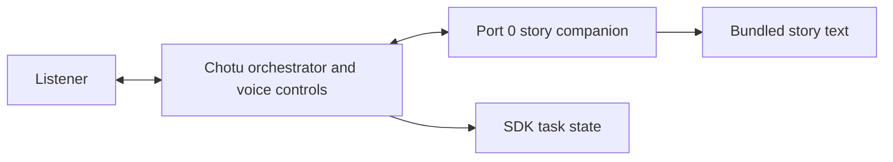
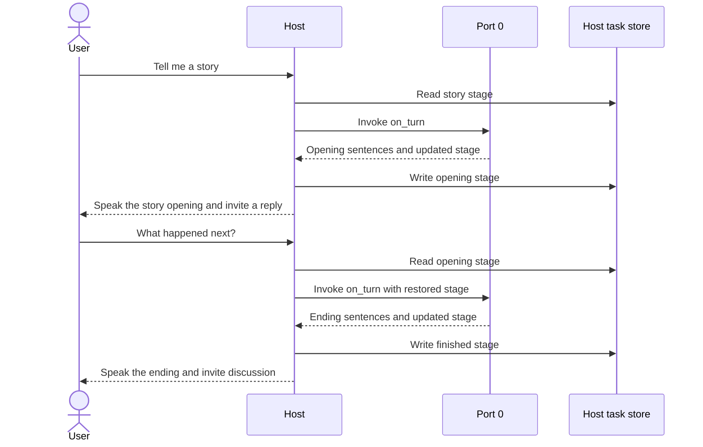
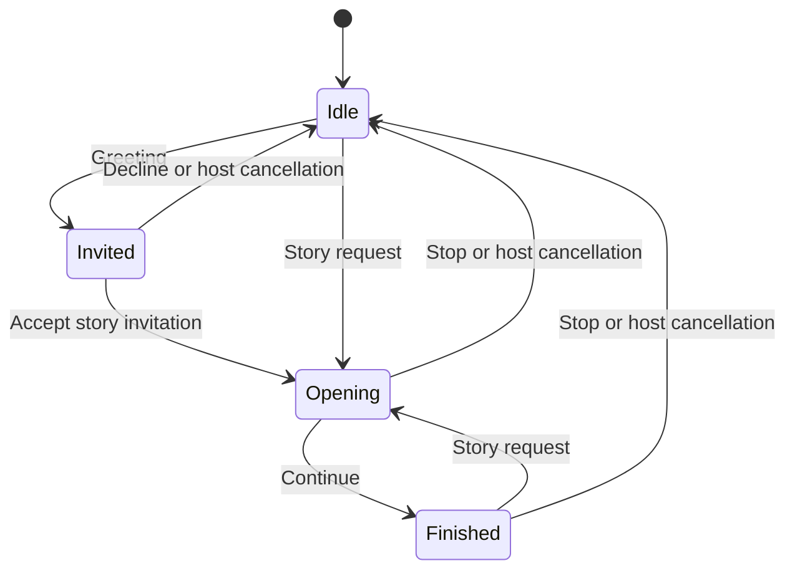

# Port 0 Story Companion · Prototype design

*Provisional draft for review. The existing prototype was generated before the required five-layer review. See the [review record](decisions.md).*

See the [current visual review](visual-review.md) for the expanded Port 0 design and the skills used to prepare it.

## Five layers

All five design layers are closed. Implementation readiness is next. The story diagrams describe the existing prototype.

1. **Identity and objectives.** Provide companionship through storytelling, weather conversation, discussion of movies and TV series, requested song playback, and gentle wellbeing check-ins. See the [Layer 1 decision](decisions.md#layer-1-decision) for boundaries and open decisions.
2. **Orchestration.** One Port 0 coordinator routes companion turns across the five capabilities and distinguishes follow-ups from topic changes. The host owns conversation routing and the speaking floor. Port 0 owns capability behavior and tool selection. See the [Layer 2 decision](decisions.md#layer-2-decision).
3. **Capabilities.** Storytelling, weather, movies and TV, music playback, and wellbeing are independently testable capabilities of one agent. Port 0 uses Tavily for lookups and Android utils for playback with a YouTube player or Android MediaPlayer, subject to the SDK tool boundary. See the [Layer 3 decision](decisions.md#layer-3-decision) for behavior and host dependencies.
4. **Interaction.** Aim for one voice turn for a clear song request. Chrome displays player status and handles local controls. The host owns turn-taking and handoffs. See the [Layer 4 decision](decisions.md#layer-4-decision).
5. **State and execution.** Use SDK session state for story progress and unresolved questions. Correlate short-lived playback commands with player results. See the [Layer 5 decision](decisions.md#layer-5-decision) for retry behavior and execution dependencies.

The state-store lane represents SDK-managed state. In the offline evaluation it is in memory, with no SQL or reminder records.

## Verification scope

Exercise opening, continuation, follow-up, stop, restart, and turn replay. The production host, voice playback, broader conversation, and localized content are outside this prototype's evaluation.

---

*© 2026 Diya Mohapatra and Satyajit Mohapatra. All rights reserved. This document and its contents are confidential and proprietary to the Owners. No part of this document, including its concepts, ideas as expressed, strategies, structure, designs, methodologies, or commercial proposals, may be copied, reproduced, adapted, modified, distributed, disclosed, or used to create any identical, substantially similar, or derivative material without the prior written consent of the Owners. Unauthorised use, disclosure, reproduction, or distribution is prohibited and may result in legal action under applicable Indian law. Subject to applicable law, disputes shall fall within the jurisdiction of the competent courts at Cuttack, Odisha, where legally maintainable.*
