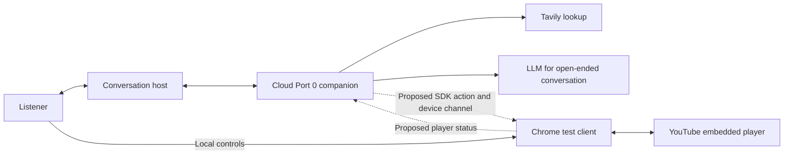
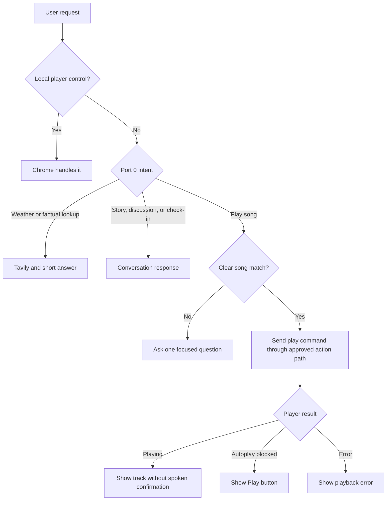
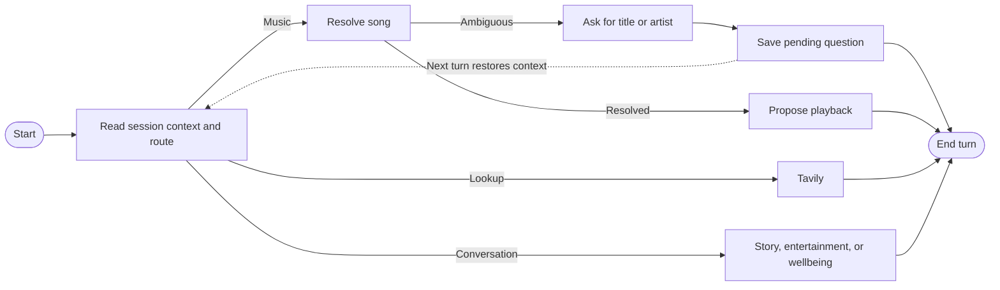
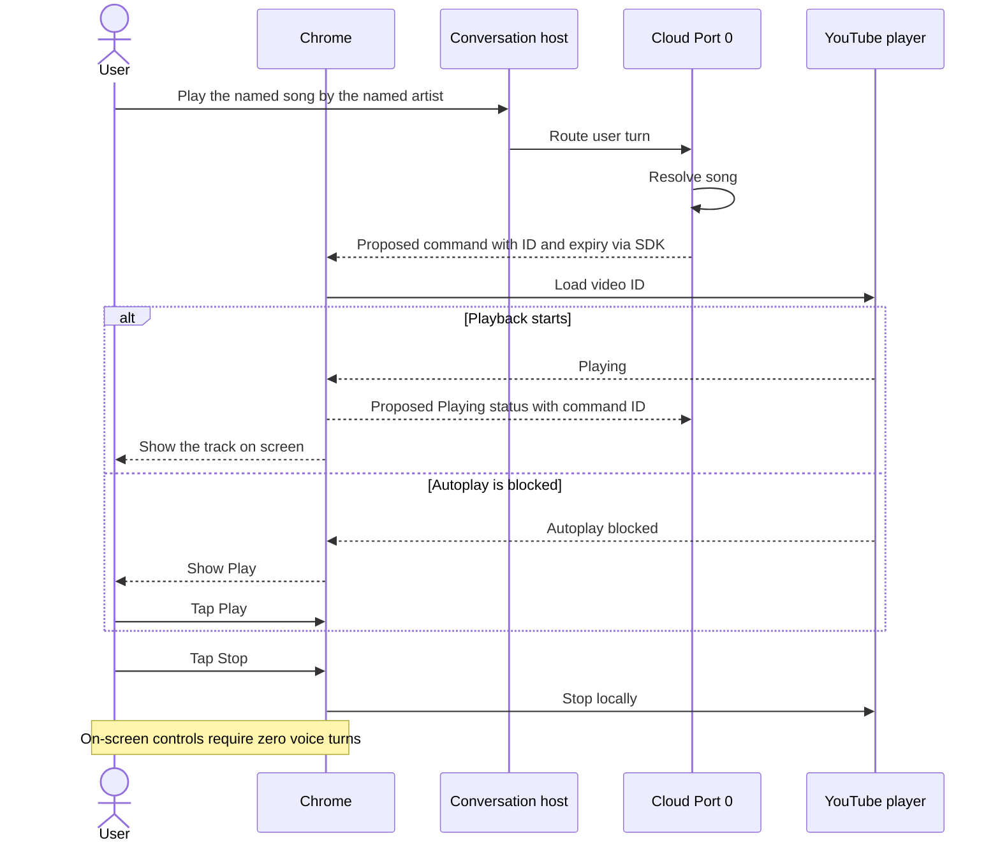
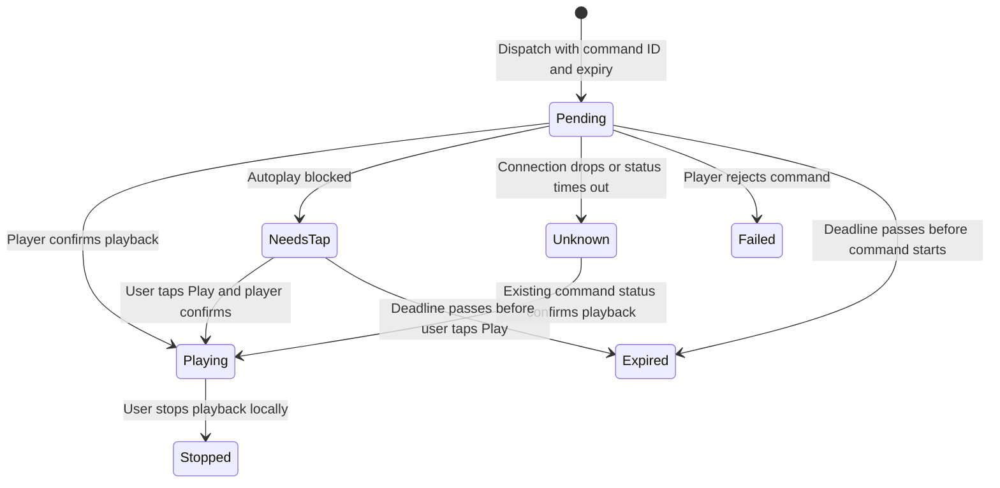
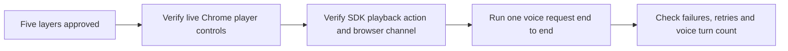
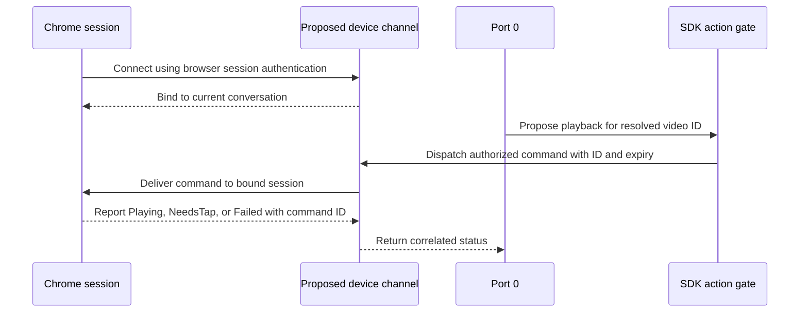

# Port 0 visual review

All five design layers are closed. The project is checking implementation readiness. End-to-end voice playback is the first release milestone. The diagrams show the proposed expanded companion. The current agent implements storytelling and scripted follow-up. The Chrome test page has local player controls and simulates receipt of a play command. The cloud command channel and SDK playback grant are pending.

## System blocks

## Capability workflow

## Candidate LangGraph flow

This is a design view. The storytelling prototype uses an SDK turn handler. Graph adoption remains open.

## Conversation and playback

This scenario has no proposed database read or write. The cloud command and callback arrows represent interfaces still to be verified.

## Playback command state

The proposed status check looks up the original command when its result is unknown. The browser deduplicates commands and rejects expired requests.

## Implementation readiness

The Codex in-app browser reported Playing, Paused, Playing, and Stopped with the live YouTube player. The volume slider moved from 70 to 69. Chrome desktop and cloud dispatch remain unverified.

## Browser channel readiness

The inspected Chotu gateway accepts utterances over its conversation socket and requires a senior ID header. A browser's native WebSocket constructor cannot set that header. The gateway has no browser playback result message, and Port 0 has no playback action grant.

For the first integration test, use the existing known video ID. Verify that a second session cannot receive or acknowledge the command, and that duplicate or expired commands do not restart playback. Run the same test with a spoken song request after the channel works.

## Skills used

| Builder skill applied | Output |
| --- | --- |
| Draw System Blocks | System blocks above |
| Draw Workflow Flowchart | Capability decisions and playback command state above |
| Draw LangGraph Flow | Candidate LangGraph flow above |
| Draw Conversation Flow | Conversation sequence above |
| List Workflow Skills | This inventory |

| Agent capability | Status |
| --- | --- |
| Storytelling and follow-up | Implemented and tested in the offline prototype |
| Weather, movies and TV, wellbeing | Proposed |
| Song playback | Live player controls verified in the Codex in-app browser. Chrome desktop and cloud routing are unverified. |

---

*© 2026 Diya Mohapatra and Satyajit Mohapatra. All rights reserved. This document and its contents are confidential and proprietary to the Owners. No part of this document, including its concepts, ideas as expressed, strategies, structure, designs, methodologies, or commercial proposals, may be copied, reproduced, adapted, modified, distributed, disclosed, or used to create any identical, substantially similar, or derivative material without the prior written consent of the Owners. Unauthorised use, disclosure, reproduction, or distribution is prohibited and may result in legal action under applicable Indian law. Subject to applicable law, disputes shall fall within the jurisdiction of the competent courts at Cuttack, Odisha, where legally maintainable.*
