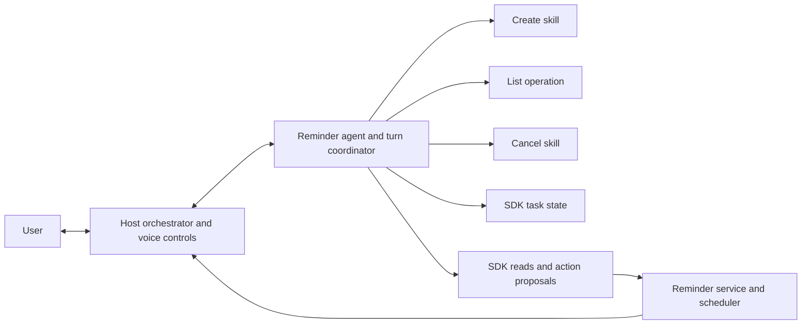
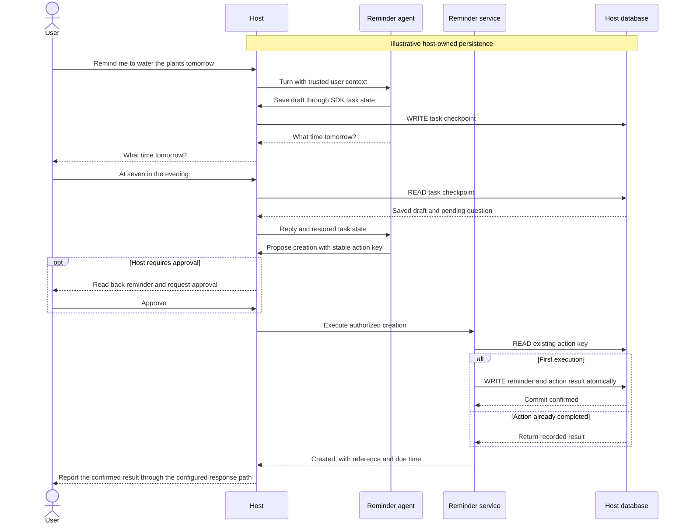
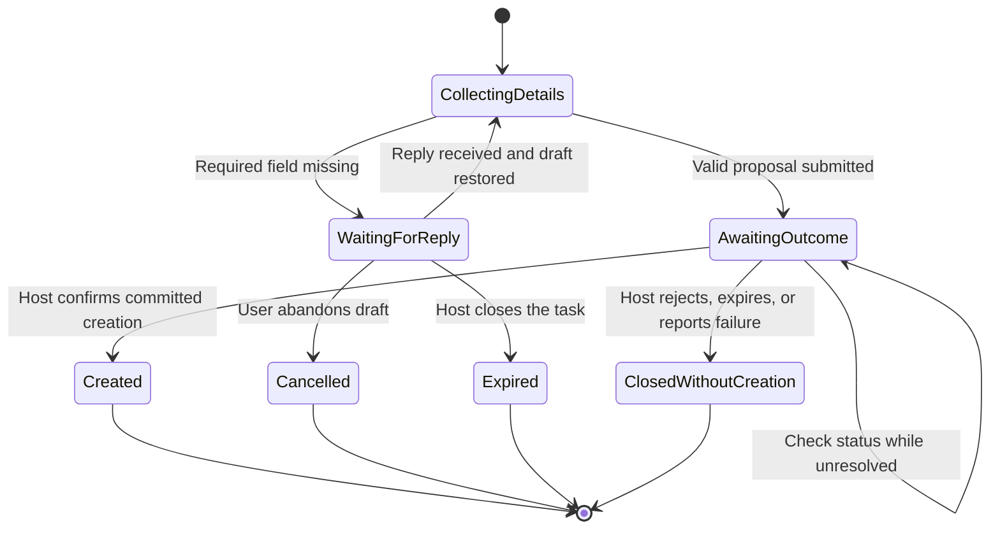

# Personal Reminder Agent · Architecture draft

*Provisional Agent Builder output for [the sample PRD](PRD.md). All five layers are open for review.*

## 1. Agent identity and objectives

Help a person create, list, and cancel their own one-time reminders (R1–R3). The agent handles the interaction. The host's reminder service stores schedules and delivers notifications after the conversation ends (R5). Route unsupported requests according to the host's handoff policy.

## 2. Orchestration and decision-making

Use one agent with a small turn coordinator. On each turn, handle an explicit cancellation or a reply to the pending question according to host policy, then route eligible new requests by intent. Use a typed task state for the active workflow. Independent deployment or permissions for the three capabilities are unnecessary for this scope.

## 3. Skills and capabilities

| Capability | Inputs and workflow | Completion |
| --- | --- | --- |
| **Create skill** (R1, R4, R6) | Collect message and local date/time. Clarify missing or ambiguous values, validate the due time using the host clock, then propose creation. | A known creation result contains a reminder reference and due time. Denied, expired, and unresolved operations are reported distinctly. |
| **List operation** (R2) | Fetch upcoming reminders through an authorized read and sort by due time if the service does not supply that order. | Return results or the appropriate empty or unavailable response under the SDK's data policy. |
| **Cancel skill** (R3, R4, R6) | Resolve a reminder from authorized results. Pause for selection if multiple entries match, verify the selection is still eligible, then propose cancellation. | Report cancellation only for a known successful result. A stale selection triggers a fresh lookup. |
| **Scheduled delivery** (R5) | The host schedules and delivers reminders using its event policy. | The service preserves the schedule across agent sessions and records delivery outcomes according to the host contract. |

## 4. User interaction and conversation management

The host owns the speaking floor and governs switching, interruption, and resumption. The agent asks one focused question when a required value is missing. A draft can be abandoned before submission. Once submitted, the agent checks the action result and follows host policy for any cancellation. A committed reminder can be cancelled through the cancel skill.

### Create reminder state

## 5. Memory, state, and execution

Persist the active skill, draft fields, pending question, expiry, and any action reference through SDK state. On resume, revalidate elapsed dates or stale selections. The reminder service owns durable records. No long-term conversational memory is needed for this scope.

Use a stable action identity per submitted change. After a timeout or repeated callback, check the known action state before retrying. A changed proposal requires the applicable approval under the host contract. The platform resolves identity and authorization from trusted context. Agent logs use correlation IDs and outcome codes and omit reminder text.

## Acceptance and review

| Requirements | Proposed verification |
| --- | --- |
| R1, R4 | Script missing time, restart at the question, supply a valid time, and verify one creation. Cancel a separate draft and verify no action is proposed. |
| R2 | Check sorted results and an authorized empty result. Exercise the SDK's unavailable-data response. |
| R3 | Return two matching reminders, select one, and verify only that item is cancelled. Exercise a stale selection. |
| R5 | End the conversation after creation, advance the host test clock, and verify the scheduled delivery attempt. |
| R6 | Simulate timeout and duplicate callbacks. Verify the agent reports uncertainty until the outcome is known and the service records one effective change. |

**Open decisions:** The engineer must confirm the target SDK revision, supported read and action interfaces, action confirmation policy, and resume or expiry behavior before code generation. Use SDK conformance and the PRD scenarios as separate verification results.

---

*© 2026 Diya Mohapatra and Satyajit Mohapatra. All rights reserved. This document and its contents are confidential and proprietary to the Owners. No part of this document, including its concepts, ideas as expressed, strategies, structure, designs, methodologies, or commercial proposals, may be copied, reproduced, adapted, modified, distributed, disclosed, or used to create any identical, substantially similar, or derivative material without the prior written consent of the Owners. Unauthorised use, disclosure, reproduction, or distribution is prohibited and may result in legal action under applicable Indian law. Subject to applicable law, disputes shall fall within the jurisdiction of the competent courts at Cuttack, Odisha, where legally maintainable.*
